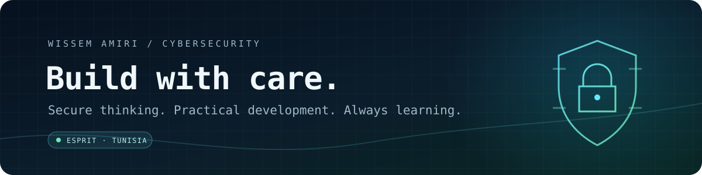

  

<h1 align="center">Wissem Amiri</h1>

  <strong>Cybersecurity Engineering student · ESPRIT · Tunisia</strong> 
  Learning software development with a security-minded approach.

  <a href="https://github.com/Wissem-AM">GitHub</a>
  &nbsp;·&nbsp;
  <a href="https://github.com/Wissem-AM?tab=repositories">Repositories</a>

---

## About

I'm studying cybersecurity engineering at **ESPRIT** and growing my development skills through hands-on learning. I'm interested in the intersection of software development and cybersecurity, and in building a strong foundation one project at a time.

## Currently learning

  
  
  
  
  
  
  

I’m building up these skills step by step; the badges describe what I’m learning, not professional-level experience.

## What I care about

- Understanding how software works, from the interface to the data behind it
- Learning to think about security while building, not only after
- Sharing practical projects and lessons as my portfolio grows

---

  Curious by nature · Building with care · Learning in public

